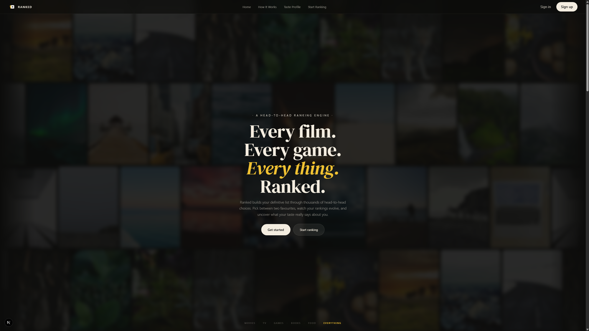
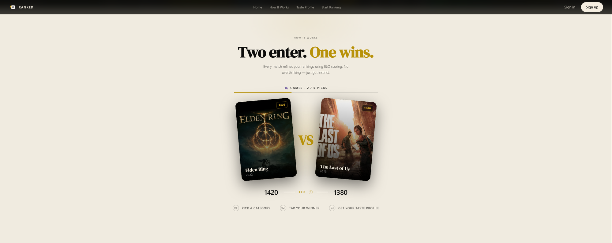
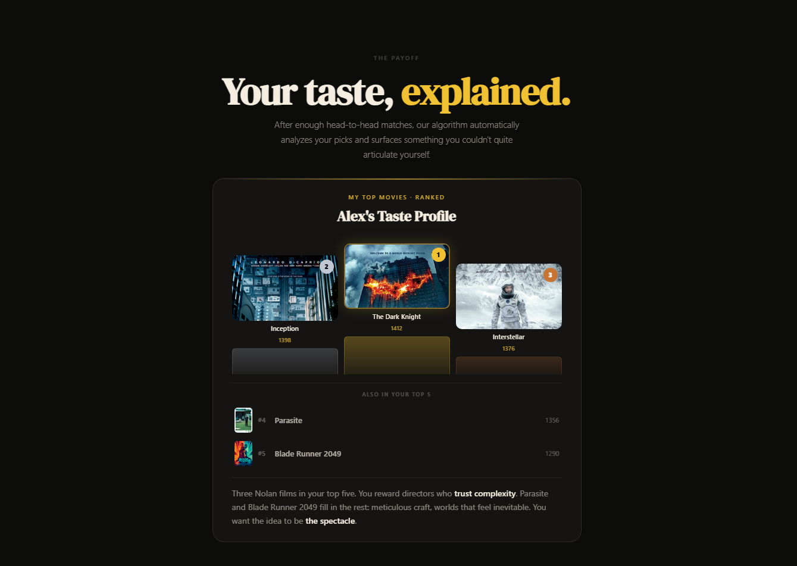
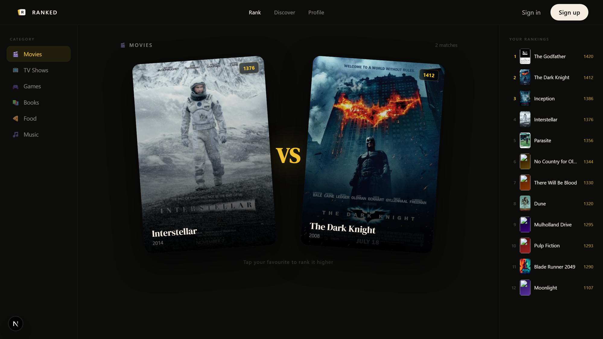

# Ranked

> **Build your definitive list through head-to-head choices.**

Ranked is a full-stack-ready web application that turns gut instinct into a scored, evolving ranking system. Instead of asking users to sort a list manually, Ranked presents two items at a time and asks a single question: *which one do you prefer?* After enough matches, an ELO-based algorithm produces a ranked list that reflects genuine preference — and an AI-generated taste profile explains what the pattern says about you.

---

## Screenshots

### Landing Page — Animated Filmstrip Hero


### How It Works — Interactive Head-to-Head Demo


### Taste Profile — AI-Powered Analysis


### Rank Page — Live ELO Leaderboard


---

## Overview

The core product insight is that humans are bad at ranking things in the abstract, but very good at comparing two things directly. Ranked exploits this by decomposing any ranking problem into a series of binary choices. Each choice feeds a live ELO rating system (the same algorithm used in competitive chess), and the result is a ranked list that is far more accurate than anything a user could produce by dragging items around manually.

The application is designed as a consumer product with a marketing landing page, a full ranking experience, community list discovery, and a personal taste profile — all built as a cohesive, production-quality UI.

---

## Features

### Core Ranking Engine
- **Head-to-head matching** — Every session presents two items from a chosen category. The user taps their preference. No lists, no drag-and-drop, no overthinking.
- **Live ELO scoring** — After each pick, both items update their ELO ratings in real time. The right sidebar leaderboard re-sorts instantly so you can watch your rankings evolve with every choice.
- **Smart pair selection** — The algorithm avoids repeating recent matchups by tracking a rolling window of played pairs, ensuring variety across a session.
- **6 categories** — Movies, TV Shows, Games, Books, Food, and Music. Each launches with its own pre-seeded dataset of 10+ items.

### Taste Profile
- **Podium display** — Top 3 items are presented on a gold/silver/bronze podium with poster art, ELO scores, and rank medals.
- **Full ranked list** — Every item in the category is displayed in ELO order with cover art and scores.
- **AI-generated analysis** — After enough picks, a taste profile paragraph surfaces patterns in the user's choices. Each category has its own analysis copy that reads like a genuine cultural observation, not a generic summary.

### Discover
- **Community lists** — A curated grid of trending lists (Top 500 Movies, Best Indie Games, Greatest Albums, etc.) with ranker counts and top-3 previews.
- **Category filters** — One-click filter tabs narrow the list grid by content type.
- **Expandable cards** — Each list card expands on click to show additional context.

### Marketing Landing Page
- **Animated filmstrip background** — Four rows of movie/game/TV poster art scroll in alternating directions using CSS keyframe animations, creating a cinematic parallax effect behind the hero headline.
- **Interactive demo** — The "How It Works" section contains a live, clickable head-to-head demo with real ELO updates and card animations. After 5 picks, a sign-up gate appears.
- **Word cloud CTA** — The footer features a dense typographic word cloud of rankable categories as a background layer, fading to reveal the headline and CTA on top.

### Auth Flow
- **Sign in / Sign up pages** — Fully designed auth screens with Google OAuth button and email/password form.
- **Mock session** — Beta mode accepts any credentials and stores a session in `localStorage`, redirecting to the profile page. Ready to wire into a real auth provider (Supabase, Clerk, NextAuth, etc.).

---

## Tech Stack

| Layer | Technology |
|---|---|
| Framework | Next.js 15 (App Router) |
| UI Library | React 19 |
| Language | TypeScript 5 |
| Styling | Tailwind CSS 3 + custom design system |
| Fonts | DM Serif Display, DM Sans (Google Fonts via Next.js) |
| Animations | CSS keyframes + IntersectionObserver (no animation library) |
| Data | Static TypeScript data layer (TMDB-ready) |
| Deployment | Vercel-ready (static export) |

---

## Architecture

This is a single-route marketing and demo application built with the Next.js App Router. All pages are client components (`'use client'`) since the ranking engine is driven entirely by local state — there is no backend or database in the current beta.

```
app/
  page.tsx          # Marketing landing page (~300 lines)
  rank/page.tsx     # Core ranking experience — ELO engine + live leaderboard
  lists/page.tsx    # Discover page — community list grid with filters
  profile/page.tsx  # User taste profile — podium + full ranked list + analysis
  signin/page.tsx   # Sign in page
  signup/page.tsx   # Sign up / create account page
  layout.tsx        # Root layout — font config, metadata
  globals.css       # Full design system — tokens, components, animations

components/
  Nav.tsx           # Shared navigation bar with active route highlighting

lib/
  data.ts           # All static data: covers, match entries, pairs, lists, rank items
```

### Data Layer (`lib/data.ts`)

All content is hardcoded in TypeScript and typed with interfaces (`Cover`, `MatchEntry`, `Pair`, `TrendingList`, `RankItem`). This makes the TMDB API the natural next integration point — `COVERS` and `RANK_ITEMS` can be replaced with live API responses without changing any component code.

### ELO Implementation

The ranking engine uses a standard ELO formula with K=32:

```
expected = 1 / (1 + 10 ^ ((opponentRating - playerRating) / 400))
newRating = currentRating + 32 * (outcome - expected)
```

Where `outcome` is `1` for a win and `0` for a loss. Both items update simultaneously after each pick. Ratings are held in React state and recalculate on every match, producing a leaderboard that converges toward accurate rankings over time.

### Design System

The entire UI is built from a custom design system defined in `globals.css` — no component library (no shadcn, MUI, Chakra, etc.).

| Token | Value | Usage |
|---|---|---|
| `--bg` | `#0c0c0b` | Page background |
| `--fg` | `#f4ede0` | Primary text (warm off-white) |
| `--gold` | `#f0c132` | Accent, ELO scores, highlights |
| `--fg-muted` | `rgba(244,237,224,0.5)` | Secondary text |
| `--font-display` | DM Serif Display | Headings, card titles, hero |
| `--font-ui` | DM Sans | Body, labels, nav |
| `--radius-card` | `14px` | Card border radius |

All spacing and typography uses `clamp()` for fluid scaling across screen sizes. Scroll-triggered animations use `IntersectionObserver` — no animation library required.

---

## Pages

### `/` — Landing Page
A full-viewport marketing page with an animated filmstrip hero, an interactive head-to-head demo (5 picks before a sign-up gate), a taste profile preview, and a word cloud footer CTA. Designed to communicate the product concept immediately without any copy-heavy explanation.

### `/rank` — Ranking Experience
The core product screen. On arrival, the user sees a 6-category grid. After selecting a category, the layout transitions to a 3-column view: a category switcher sidebar, a large head-to-head match arena, and a live ELO leaderboard. Switching categories resets the session and loads a new item pool.

### `/lists` — Discover
A filterable grid of community-curated lists. Each card shows the list name, item count, top 3 ranked items, and a ranker count. Cards expand on click. Filter tabs let users browse by content type.

### `/profile` — Taste Profile
A personal profile page with category tab navigation, a top-3 podium with poster art and medal overlays, a full ranked list, and an AI-generated taste analysis paragraph per category.

### `/signin` + `/signup` — Auth
Minimal, on-brand authentication screens with Google OAuth (mocked in beta) and email/password forms. Beta mode accepts any credentials and stores a mock session in `localStorage`.

---

## Local Development

```bash
# Install dependencies
npm install

# Start dev server
npm run dev
# → http://localhost:3000

# Production build
npm run build

# Lint
npm run lint
```

**Beta test credentials** (sign in page pre-fills these):
- Email: `demo@ranked.app`
- Password: `ranked123`

Any credentials entered on the sign-up page will also work.

---

## Roadmap

- [ ] TMDB API integration — replace static covers with real poster art
- [ ] Supabase backend — persist ELO scores and session data per user
- [ ] Real Google OAuth via NextAuth or Clerk
- [ ] Social sharing — share your taste profile as an image card
- [ ] Head-to-head with friends — compare two users' rankings
- [ ] Mobile app — React Native with shared data layer

---

## Project Structure

```
ranked/
├── app/
│   ├── globals.css        # Design system, tokens, animations
│   ├── layout.tsx         # Root layout, font imports, metadata
│   ├── page.tsx           # Landing page
│   ├── rank/page.tsx      # Ranking experience
│   ├── lists/page.tsx     # Discover page
│   ├── profile/page.tsx   # Taste profile
│   ├── signin/page.tsx    # Sign in
│   └── signup/page.tsx    # Sign up
├── components/
│   └── Nav.tsx            # Shared nav
├── lib/
│   └── data.ts            # Static data + TypeScript interfaces
├── public/
│   └── logo.png           # App icon
└── docs/
    └── screenshots/       # README images
```

---

Built by [Adi El-Sammak](https://github.com/aelsammak) · Powered by [Next.js](https://nextjs.org)
